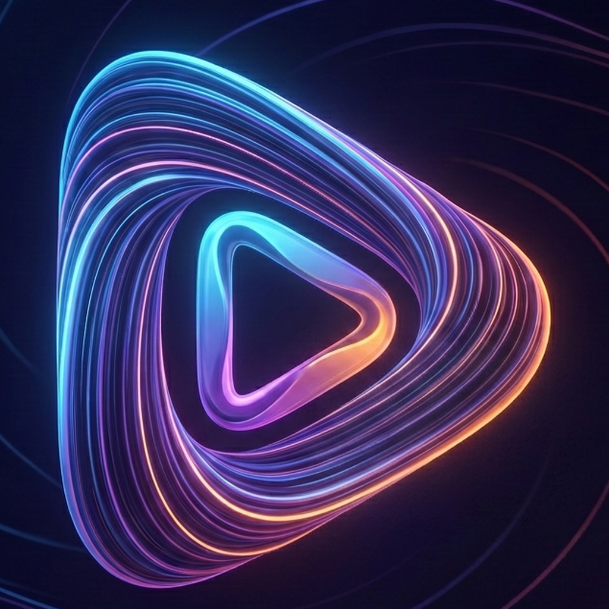

<div align="center">



# Clip Architect

**Turn a topic into a finished short video — on your own machine, with your own keys.**

[](https://apps.microsoft.com/store/detail/9NG0GZBHJMLR?cid=DevShareMCLPCS)

**[Install from the Microsoft Store](https://apps.microsoft.com/store/detail/9NG0GZBHJMLR?cid=DevShareMCLPCS)** — one click, no build steps, updates handled by Windows.

[](https://diflowrin.com)
[](LICENSE)
[](COMMERCIAL-LICENSE.md)
[](https://apps.microsoft.com/store/detail/9NG0GZBHJMLR?cid=DevShareMCLPCS)
[](#requirements)
[](https://tauri.app)
[](https://react.dev)
[](https://www.python.org)

[**diflowrin.com**](https://diflowrin.com) — project page, downloads and release notes.

</div>

---

Clip Architect is a desktop build of
[MoneyPrinterTurbo](https://github.com/harry0703/MoneyPrinterTurbo): give it a
subject, and an LLM writes the script and the search keywords, stock footage or
your own files supply the picture, a text-to-speech engine speaks the narration,
and FFmpeg cuts the clips to the voice track, burns in subtitles, mixes
background music and writes an MP4 sized for TikTok, Reels or Shorts.

Upstream is a Python web app (FastAPI + a Streamlit UI) that you start from a
terminal and use in a browser. This repackages it as a single Windows
application: a Tauri shell owns the window and the process lifecycle, a React
frontend replaces Streamlit, and the Python backend runs as a private local
service that starts and stops with the app.

**Local-first.** Everything runs on your machine. Nothing is uploaded anywhere
except to the provider you chose, with the key you supplied. No account, no
subscription, no cloud render queue.

## See it

<div align="center">

| [](https://youtu.be/ubOvgj6U__A) | [](https://youtu.be/S8d96ijZHu4) |
|:--:|:--:|
| **[Clip Architect Desktop](https://youtu.be/ubOvgj6U__A)** — the app itself. | **[Bass Through the Cosmos](https://youtu.be/S8d96ijZHu4)** — a short made with it. |

</div>

## Features

- **Script and keywords from any of 23 LLM providers** — OpenAI, Anthropic
  Claude, Google Gemini, DeepSeek, Qwen, Moonshot/Kimi, xAI Grok, Groq,
  OpenRouter, Ollama and more. Adding one is a registry entry, not a code path.
- **Footage** from Pexels, Pixabay, or your own local video files.
- **Narration** via Edge TTS (free, no account), Azure Speech, or ElevenLabs.
  Voices are listed per engine, and the app says up front when a key is missing
  instead of failing silently at the render stage.
- **Burned-in subtitles** with a choice of bundled font, size, position, colour
  and outline, previewed before you render.
- **Background music** from the 8 bundled tracks or your own uploads.
- **Review before render** — an optional pass that downloads the clips and lets
  you reorder, remove or replace any of them before spending the minutes and
  the provider quota. A clip can be replaced with a file of your own or with a
  fresh one fetched by keyword; asking again offers a clip you have not been
  shown yet, falling through to another stock provider when one runs dry. Finished tasks can be reopened for another pass.
- **Voice-over first** — record and listen to the narration on its own, with its
  duration, before committing to a full render.
- **Saved projects and a library** of past renders, plus a reusable cache of
  downloaded clips shared across tasks.
- **Output at 9:16, 16:9 or 1:1.**

Every product-facing string is in English.

## Requirements

- Windows 10 1809 or newer, with the WebView2 runtime
- [Rust](https://rustup.rs/) with the MSVC toolchain
- Node.js 20+
- [uv](https://docs.astral.sh/uv/) (the backend pins Python 3.11)

FFmpeg is bundled (an LGPL build), so end users do not need to install it. It
is ~110 MB and therefore not in version control — fetch it once with
`npm run ffmpeg:fetch`.

It must stay an LGPL build. See [Third-party licenses](LICENSES-third-party.md)
for why: a GPL build carries libx264, and distributing an H.264 encoder brings
patent licensing that the app avoids by calling the encoder built into Windows.

## Development

```bash
# once
npm install
npm run backend:sync     # uv sync --python 3.11 in backend/
npm run ffmpeg:fetch     # LGPL FFmpeg -> backend/resource/bin/

# run
npm run tauri:dev
```

In debug builds the Rust shell runs `backend/sidecar.py` directly from the uv
virtualenv, so Python changes only need an app restart — no re-freezing. It
still passes `MPT_ROOT_DIR` and `MPT_RESOURCE_DIR`, so the dev and release
layouts behave identically.

### Checks

```bash
npm run backend:test     # pytest
npm run build            # tsc -b + vite build (catches more than tsc --noEmit)
npm run lint             # oxlint
cd src-tauri && cargo check && cargo test
```

`tsc --noEmit` does not apply the project tsconfig — use the npm script.
`cargo check` alone only compiles the `debug_assertions` branch of the backend
command; add `--release` to cover the release-only path.

## Architecture

```
┌─────────────────────────────────────────────────┐
│ ClipArchitect.exe          (Tauri / Rust)       │
│                                                 │
│  ├── WebView2 ── React + TypeScript frontend    │
│  │                    │                         │
│  │                    │ HTTP to 127.0.0.1:<port>│
│  │                    ▼                         │
│  └── supervises ── ca-desktop-backend.exe       │
│                    (PyInstaller: FastAPI +      │
│                     moviepy + ffmpeg + TTS)     │
└─────────────────────────────────────────────────┘
```

The Rust shell ([`src-tauri/src/backend.rs`](src-tauri/src/backend.rs)) reserves
a free loopback port, starts the backend with that port, waits for it to accept
connections, and kills it on exit. The frontend never assumes a fixed port: it
receives the base URL from the shell over the `backend://status` event. The
child is assigned to a Windows Job Object with `KILL_ON_JOB_CLOSE`, so a crash
or a Task Manager kill cannot leave the backend rendering in the background.

First startup is slow — around 70 s cold while Defender scans the ~290 MB
bundle, ~20 s warm — so the startup timeout is deliberately generous.

### Repository layout

| Path | What it is |
|---|---|
| `src/` | React frontend: three views — Generate, Library, Settings |
| `src-tauri/` | Rust shell: window, process supervision, capabilities |
| `backend/app/` | Vendored MoneyPrinterTurbo, patched where noted in LICENSES-third-party.md |
| `backend/sidecar.py` | Entry point when run as a Tauri sidecar (replaces upstream `main.py`) |
| `backend/test/` | Upstream suite, minus tests for components not shipped |
| `packaging/` | Upstream tests and assets held out of the shipped build |
| `scripts/` | FFmpeg fetch, and the resource-dir guard both tauri commands need |

### Where files live

Upstream derives every path from `__file__`, which breaks the moment the code
runs from a read-only install directory or a PyInstaller temp folder. The
backend resolves two directories from the environment
([`backend/app/paths.py`](backend/app/paths.py)):

| Variable | Contents | Writable |
|---|---|---|
| `MPT_ROOT_DIR` | `config.toml`, `storage/` (renders, downloaded footage, uploads) | yes — per-user app data |
| `MPT_RESOURCE_DIR` | `fonts/`, `songs/`, `public/`, `bin/ffmpeg.exe` | no — inside the install |

Both fall back to the source-tree layout when unset, so a plain
`python sidecar.py` still behaves like upstream.

This split is what makes a Microsoft Store (MSIX) build possible: MSIX installs
under `C:\Program Files\WindowsApps`, which the app cannot write to.

## Release build

The Python backend must be frozen first; the Tauri build only bundles what is
already on disk.

```bash
npm run backend:freeze   # PyInstaller -> backend/dist/backend/
npm run tauri:build      # -> src-tauri/target/release/
```

Skipping the freeze ships stale Python — the frozen bundle goes out of date
silently, because dev builds never touch it.

`sidecar.spec` produces a one-**directory** bundle on purpose. A one-file build
re-extracts several hundred megabytes into `%TEMP%` on every launch, which is
slow and trips antivirus heuristics; MSIX also expects a static, pre-laid-out
payload.

A release bumps two literals that no check ties together: `version` in
`src-tauri/tauri.conf.json` and the version in the sidebar (`src/App.tsx`).

## Backend API

The frontend talks to a plain HTTP API under `/api/v1`; `/docs` on the backend's
port serves the generated OpenAPI UI during development.

| Method | Path | Purpose |
|---|---|---|
| `POST` | `/videos` | Queue a full render, returns `task_id` |
| `POST` | `/materials` | Prepare materials and stop for review |
| `POST` | `/audio` | Record the narration only |
| `POST` | `/subtitle` | Generate subtitles only |
| `POST` | `/tasks/{id}/render` | Render a reviewed task from its approved clips |
| `POST` | `/tasks/{id}/reopen` | Reopen a finished task's clips for another pass |
| `POST` | `/tasks/{id}/material_search` | Fetch one stock clip by keyword, to swap into a reviewed list |
| `GET` | `/tasks` | Paginated task list |
| `GET`/`DELETE` | `/tasks/{id}` | Task state and progress / delete it and its output |
| `POST` | `/scripts` | Generate a script with the configured LLM |
| `POST` | `/terms` | Generate stock footage keywords |
| `POST` | `/social-metadata` | Generate a title, description and hashtags |
| `GET`/`POST` | `/musics` | List / upload background music |
| `GET`/`POST` | `/video_materials` | List / upload local footage |
| `GET`/`DELETE` | `/downloaded_materials` | The shared clip cache / delete one clip |
| `GET` | `/material_preview/{path}`, `/material_thumbnail/{path}` | Stream a clip, or a still frame generated on demand |
| `GET`/`POST`/`PUT`/`DELETE` | `/projects`, `/projects/{id}` | Saved projects |
| `GET`/`PUT` | `/settings` | Read and persist `config.toml` |
| `GET` | `/metadata/{fonts,voices,llm-providers,llm-models}` | Form options |
| `GET` | `/ping` | Health check the shell waits on |

The `settings`, `metadata`, `projects` and review routes are additions. Upstream
had no need for them because Streamlit ran inside the backend process and edited
configuration in memory; a separate frontend cannot.

## Configuration

Everything is stored in `config.toml` in the app data folder, editable from the
Settings tab. Nothing ships with credentials — the app is inert until you supply
at least an LLM provider key and, unless rendering from local files, a Pexels or
Pixabay key.

The credential-free path is **local footage + Edge TTS**, which needs no account
at all. That path matters twice over: it is the honest first run for a new user,
and it is what a Microsoft Store certification reviewer — testing on a clean
install with no accounts — needs in order to see the app do anything.

## Known limitations

- **Windows only.** The shell, the MSIX packaging and the `h264_mf` encoder are
  all Windows-specific.
- **No CJK subtitle font ships.** Latin, Vietnamese, Cyrillic, Greek and Thai
  are covered; Chinese, Japanese and Korean render as blank glyphs rather than
  failing.
- **H.264 is Constrained Baseline**, because it is encoded through Windows Media
  Foundation rather than a bundled encoder. Files are larger than libx264 would
  produce. This is a patent decision, not an oversight; HEVC is never emitted.
- Several upstream integrations are vendored but not surfaced in the UI —
  LoomLoom video generation, TwelveLabs reranking, social cross-posting. They
  live in `backend/app/services/`. Sonilo and ElevenLabs music generation used
  to be on this list; a key under Settings → AI background music now adds them
  to the Background music picker.

## License

Clip Architect is **dual-licensed**.

### GPL-3.0 — for the community

The default, and the licence in [LICENSE](LICENSE). Free of charge, for everyone.
Use it, study it, modify it, and make videos with it — including videos you sell.
What GPL-3.0 asks in return is that if you **distribute** the software or
anything derived from it, you do so under GPL-3.0 too, with source.

### Commercial license — for proprietary use

For what the GPL does not permit: embedding Clip Architect in a closed-source
product, redistributing it without publishing source, or shipping it under your
own brand. Granted by written agreement with the author, with optional technical
support and SLA. See [COMMERCIAL-LICENSE.md](COMMERCIAL-LICENSE.md).

### Either way, the videos are yours

Neither licence claims any right over the material Clip Architect produces. What
you render is yours to publish, sell or monetise. The same goes for what you put
in — your footage and your scripts stay yours. Only the terms of the providers
you configure, and the licences of what the app bundles, apply on top.

---

The upstream MoneyPrinterTurbo code is MIT and keeps its notice
([`LICENSE-MoneyPrinterTurbo`](LICENSE-MoneyPrinterTurbo)); MIT is one-way
compatible with the GPL, so the combined work ships under GPL-3.0. Nothing
bundled forces that choice — the FFmpeg build is LGPL — so it is a preference,
not an obligation inherited from a dependency. That is also what makes the
second licence possible: nothing shipped here carries a copyleft obligation the
author cannot waive.

[LICENSES-third-party.md](LICENSES-third-party.md) covers the bundled fonts,
music, FFmpeg and codec selection, and documents what was removed from upstream
and why. Read it before shipping — several of those removals were licensing
blockers, not cleanups.

[`licenses/`](licenses/) is the copy that ships. The folder is bundled as an
application resource, so an installed Clip Architect carries the GPL-3.0, MIT,
LGPL, OFL and Python dependency texts on disk beside the executable, where
several of those licences require them to be. `LICENSES-third-party.md` holds
the reasoning; [`licenses/THIRD-PARTY-NOTICES.md`](licenses/THIRD-PARTY-NOTICES.md)
is the notice a user or a certification reviewer actually reads.

## Credits

Built on [MoneyPrinterTurbo](https://github.com/harry0703/MoneyPrinterTurbo) by
Harry. Shell by [Tauri](https://tauri.app). Media by
[FFmpeg](https://ffmpeg.org) (LGPL build) and
[MoviePy](https://zulko.github.io/moviepy/).

### Thanks to the footage providers

Clip Architect does not host a single frame of stock video. Everything it cuts
comes from the two libraries below, fetched at render time with **your own free
API key**, and both are thanked here because the app would have nothing to show
without them:

- **[Pexels](https://www.pexels.com)** — free stock video, no attribution
  required, under the [Pexels License](https://www.pexels.com/license/).
  Get a key at [pexels.com/api](https://www.pexels.com/api/).
- **[Pixabay](https://pixabay.com)** — free stock video under the
  [Pixabay Content License](https://pixabay.com/service/license-summary/).
  Get a key at [pixabay.com/api/docs](https://pixabay.com/api/docs/).

Both licences allow commercial use of the finished video, and neither requires
crediting the clip in it — but the terms are theirs to change, and they are
worth reading before you publish at scale. Crediting a creator you liked costs
nothing and is the reason the libraries stay free.

The **local footage + Edge TTS** path needs no stock
provider and no account at all.
